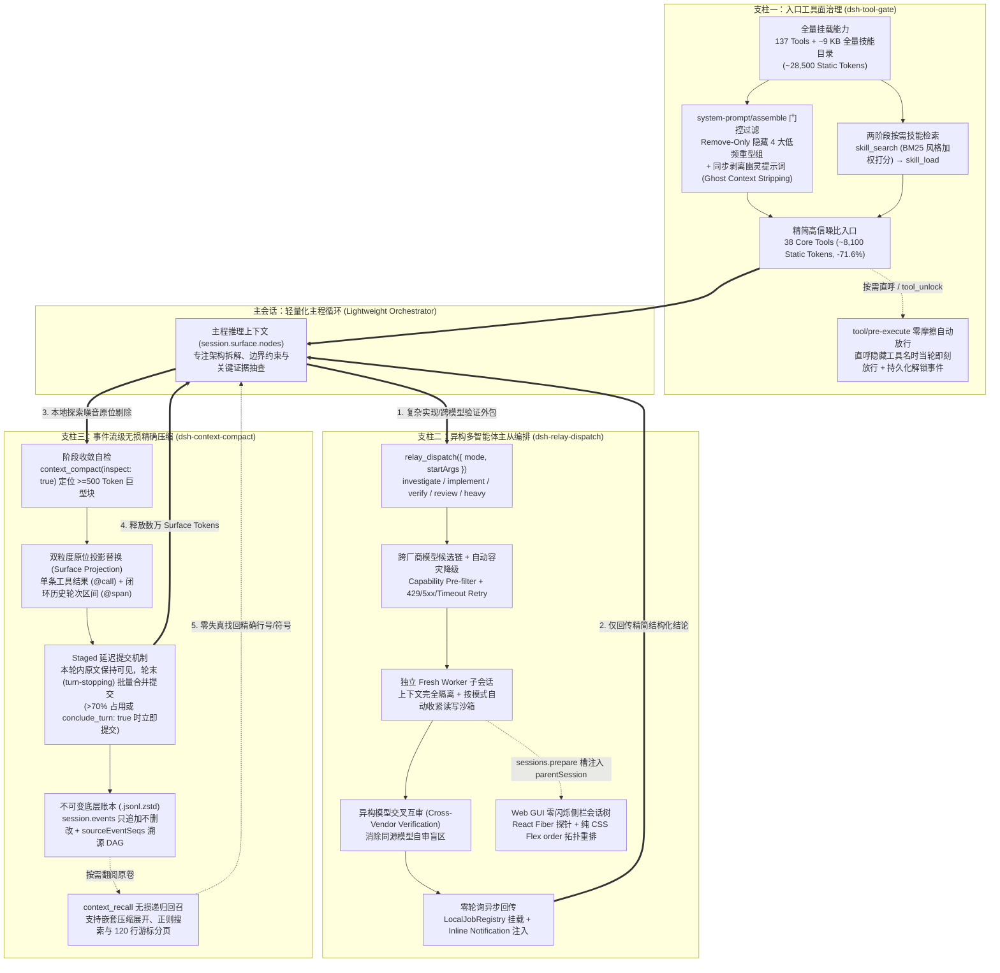

# DeepSeek Harness Engineering Portfolio — Production Agent Infrastructure

[](./LICENSE)
[-0f172a.svg)](https://github.com/mikonnyan/dsh-harness-portfolio)
[](#quick-start--verification--快速验证)

> **Flagship Agent Infrastructure & Context Engineering Suite for Long-Horizon Coding Agents**  
> **面向长周期软件工程 Agent 的生产级基础设施与上下文治理作品集**

---

## Executive Summary (English)

As autonomous coding agents scale from single-turn scripts to long-horizon software engineering systems connected to dozens of MCP servers, browser automation tools, and domain skills, three structural bottlenecks inevitably degrade agent reliability:

1. **First-Turn Action-Space & Prompt Bloat**: Exposing 100+ tool schemas and static skill catalogs inflates every request header by ~28.5k tokens, fractures prefix KV caches, and dilutes model attention (*Lost-in-the-Middle*).
2. **Monolithic Session Pollution & Self-Review Blind Spots**: Running search, heavy code edits, test debugging, and code review inside a single session floods the context window with transient noise, while evaluating code with the same model family introduces homogeneous blind spots.
3. **Destructive Rolling Summarization (*Anchor Collapse*)**: Traditional context compaction replaces message history with lossy natural-language summaries, erasing exact line numbers, file paths, symbol names, and error codes—forcing agents into repetitive re-reading loops.

This repository presents **three orthogonal, production-verified runtime plugins** built on the **DeepSeek Harness (DSH)** Cordis dependency-injection kernel. Together, they form a closed-loop **Input Governance → Execution Isolation → Memory Compaction** architecture:

- **[`@dsh-external/dsh-tool-gate`](./packages/dsh-tool-gate)** — **Tool Surface Governance**: Gates 4 heavy tool groups (`137 → 38` default tools) and replaces the ~9 KB static `<available_skills>` prompt block with two-phase on-demand skill loading (`skill_search` + `skill_load`), cutting static first-turn prompt overhead by **71.6%** with **zero-friction pre-execution auto-unlock** and synchronized ghost-context stripping.
- **[`@dsh-external/dsh-relay-dispatch`](./packages/dsh-relay-dispatch)** — **Heterogeneous Multi-Agent Orchestration**: Decouples the main session into a lightweight **Orchestrator** that dispatches isolated **Fresh Workers** across heterogeneous model vendors (e.g., Claude, GPT, Gemini, Grok) with capability-aware fallback chains, Eliminates `wait_run` polling loops via inline job notifications, and renders a zero-flicker parent-child session tree in the Web GUI via React Fiber introspection + pure CSS Flex `order`.
- **[`@dsh-external/dsh-context-compact`](./packages/dsh-context-compact)** — **Surgical Context Compaction**: Separates the immutable append-only event ledger (`session.events` / `.jsonl.zstd`) from the active LLM projection (`session.surface.nodes`). Empowers the agent to surgically replace individual tool results (`@call:<callId>`) or closed multi-turn spans (`@span:S<start>-<end>`) with high-density engineering conclusions, featuring **staged end-of-turn commits** and **recursive lossless recall** (`context_recall`) over nested `sourceEventSeqs` DAGs.

---

## 架构总览：三大核心支柱的协同闭环（Chinese Overview）

在生产级 Coding Agent 运行时（DeepSeek Harness）中，**高信噪比的上下文窗口（High-SNR Context Window）** 是决定多步推理上限的第一性稀缺资源。本作品集从 **入口降噪（事前）**、**主从隔离与异构互审（事中）**、**事件流无损手术刀压缩（事后）** 三个维度构建了完整的 Agent Harness Engineering 闭环：



---

## 核心量化指标总表（Key Engineering Metrics）

| 维度 / 模块 | 核心工程指标 | 优化前（Baseline） | 优化后（Portfolio） | 关键技术机制 |
| :--- | :--- | :--- | :--- | :--- |
| **工具面与技能治理**<br/>`dsh-tool-gate` | 默认暴露工具数<br/>首轮静态 Prompt 开销<br/>技能目录静态注入<br/>复杂多步锚定遵循率<br/>首次调隐藏工具额外往返 | `137` 个工具<br/>`~28,500` Tokens<br/>`~9 KB` (`<available_skills>`)<br/>严重劣化（实测跌至 `0/9`）<br/>报错重试需 `+1` 轮 RTT | **`38` 个核心工具 (`-72.3%`)**<br/>**`~8,100` Tokens (`-71.6%`)**<br/>**`0 Bytes` 静态目录 (`-100%`)**<br/>**恢复至 `~81%` 基线水平**<br/>**`0` 额外轮次 (`Auto-Unlock`)** | 4 大重型工具组默认门控 (`dev`/`relay`/`connector`/`browser`)<br/>`filterTools` + `filterContexts` 幽灵上下文同步剥离<br/>`skill_search` + `skill_load` 两阶段按需加载<br/>`tool/pre-execute` 零摩擦自动解锁与事件流持久化 |
| **异构多智能体调度**<br/>`dsh-relay-dispatch` | 子任务等待期間主程轮询<br/>跨厂商互审与容灾降级<br/>主会话上下文污染<br/>Web 侧栏父子拓扑渲染 | 手动循环 `wait_run` 空转烧 Token<br/>单模型硬编码、自审同源盲区<br/>检索与排错噪音全部堆积主会话<br/>平铺无层级或 DOM 搬移导致 React 崩溃 | **`0` 轮询（异步通知自动唤醒）**<br/>**多候选链热读 + 自动跨渠道降级**<br/>**Fresh 子会话完全隔离，仅回传摘要**<br/>**零闪烁树状折叠（零 React Reconciliation 冲突）** | `LocalJobRegistry` + `injectInlineNotification`<br/>`dispatch-modes.yaml` 热加载 + `isModelError` 分类重试<br/>`sessions.prepare` 并发安全槽注入 `meta.parentSession`<br/>React Fiber 向上探针 + 纯 CSS `order` 与自定义属性驱动 |
| **事件流精确上下文压缩**<br/>`dsh-context-compact` | 压缩粒度与锚点保留度<br/>单次巨型噪音清理典型收益<br/>底层历史数据有损率<br/>当轮推理上下文连续性<br/>Prefix KV Cache 友好度 | 全量滚动摘要，行号/符号/错误码丢失<br/>全盘重写历史，好坏上下文同归于尽<br/>破坏性覆盖（原文永久不可逆丢失）<br/>当轮立即截断，打断后续工具链<br/>历史头部重写导致 Prefix Cache 全失效 | **`@call` 单条结果 + `@span` 区间级手术刀**<br/>**3 条大输出原位替换即削减 `~21k` Surface Tokens**<br/>**`0%` 有损（100% 底层保留 + 递归回召）**<br/>**Staged 轮末延迟提交，本轮内原文可见**<br/>**静态指令走 `systemPrompt.section` 稳固缓存前缀** | `session.events` 追加日志与 `surface.nodes` 投影分离<br/>`surfaceOp: { op: 'replace' }` 区间合并提交<br/>`sourceEventSeqs` 溯源 DAG 递归展开 + 深度上限保护<br/>`conclude_turn: true` 同轮结轮省 1 次 LLM RTT |

---

## 快速导航（Repository Navigation）

### 1. 源码包（Packages）

| 包路径 | 包名 | 核心定位与亮点 | 包内文档 |
| :--- | :--- | :--- | :--- |
| [`packages/dsh-tool-gate`](./packages/dsh-tool-gate) | `@dsh-external/dsh-tool-gate` | **工具面门控与按需技能引擎**：4 大工具组按需开关、`/tools` 交互面板、零摩擦自动放行、BM25 风格中英混合 `skill_search` 与 `skill_load`。 | [`packages/dsh-tool-gate/README.md`](./packages/dsh-tool-gate/README.md) |
| [`packages/dsh-relay-dispatch`](./packages/dsh-relay-dispatch) | `@dsh-external/dsh-relay-dispatch` | **异构多模型主从调度器与侧栏会话树**：6 大预设派发模式、模型能力预检与故障降级链、后台生命周期管理、React Fiber + CSS Flex `order` 零闪烁侧栏树。 | [`packages/dsh-relay-dispatch/README.md`](./packages/dsh-relay-dispatch/README.md) |
| [`packages/dsh-context-compact`](./packages/dsh-context-compact) | `@dsh-external/dsh-context-compact` | **事件流级无损精确压缩与回召**：`@call` / `@span` 双粒度原位投影替换、Staged 轮末延迟提交、`conclude_turn` 结轮优化、`sourceEventSeqs` 递归无损 `context_recall`。 | [`packages/dsh-context-compact/README.md`](./packages/dsh-context-compact/README.md)<br/>[`packages/dsh-context-compact/MIGRATION.md`](./packages/dsh-context-compact/MIGRATION.md) |

### 2. 深度架构复盘文档（Architecture Deep-Dives）

- **模块 01**：[`docs/01-tool-surface-governance.md`](./docs/01-tool-surface-governance.md) — *Agent 工具面治理与按需技能加载架构复盘（137 → 38 工具门控、幽灵上下文剥离、零摩擦自动放行与两阶段技能检索）*
- **模块 02**：[`docs/02-heterogeneous-multi-agent-dispatch.md`](./docs/02-heterogeneous-multi-agent-dispatch.md) — *异构多模型主从调度与零闪烁侧栏会话树（Orchestrator-Worker 上下文隔离、跨厂商互审、非阻塞通知与 React Fiber 侧栏树渲染）*
- **模块 03**：[`docs/03-surgical-context-compaction.md`](./docs/03-surgical-context-compaction.md) — *事件流级无损精确上下文压缩：告别有损滚动摘要的 Agent 记忆手术刀（Events vs. Surface 分离、双粒度原位替换、Staged 提交与 DAG 递归无损回召）*

---

## 三大核心模块深度解析（Pillar Highlights）

### Pillar 1: Tool Surface Governance (`@dsh-external/dsh-tool-gate`)

- **Remove-Only 严格白名单安全边界**：在 `system-prompt/assemble` 钩子中只做减法不做加法，绝不绕过宿主 Profile、Agent Preset 或权限沙箱策略。子代理（`delegationDepth > 0`）默认豁免门控，确保被委派的专职 Worker（如浏览器测试子代理）开箱即用全部工具。
- **消除“幽灵指令”幻觉（Synchronized Context Stripping）**：当某个工具组（如 `dev`）处于关闭状态时，同步扫描并剔除 `assembled.contexts` 中匹配的运行时提示词片段（如 `dsh-super-injector` 注入的热重载引导语），彻底杜绝“提示词教模型调工具，但工具声明已被隐藏”的幻觉死循环。
- **零摩擦自动解锁（Zero-Friction Auto-Unlock）**：若模型已知某个被隐藏工具的精确名称（如从用户指令中直接看到 `dev_reload_package`）并直接发起调用，`tool/pre-execute` 钩子会在执行前毫秒级拦截、自动解锁对应工具组并写入持久化会话事件，当轮调用直接放行成功，实现 **0 报错、0 额外轮次开销**。

### Pillar 2: Heterogeneous Multi-Agent Orchestration (`@dsh-external/dsh-relay-dispatch`)

- **模式驱动的语义化派发（Mode-Driven Dispatch）**：通过 `~/.dsh/dispatch-modes.yaml`（支持每次调用热读取）定义 `investigate`、`implement`、`verify`、`review`、`heavy` 等模式，自动配齐读写沙箱边界（`read-only` vs. `danger-full-access`）、推理强度（`reasoningEffort`）、前置纪律约束（`taskPrefix`）与结构化交付契约（`deliverable`）。
- **跨厂商异构互审（Cross-Vendor Verification）**：支持为编码实现（`implement`）与独立验证/代码审查（`verify` / `review`）绑定不同厂商的模型候选链，利用模型家族间的分布差异消除同源盲区；并在遇到 `429 Rate Limit`、`5xx`、超时或模型不可用时自动沿候选链无缝降级。
- **零 DOM 破坏的 React 侧栏会话树**：不在宿主 React 虚拟 DOM 管理的容器内移动或增删节点（避免触发 `NotFoundError: removeChild`），而是通过讀取 DOM 节点的 `__reactFiber$` 指针精准提取会话 UUID，结合纯 CSS `display: flex` + `order` 重排与 `--dsh-tree-depth` 缩进变量，实现零闪烁的父子会话折叠树与孤儿节点自动降级保护。

### Pillar 3: Surgical Context Compaction (`@dsh-external/dsh-context-compact`)

- **不可变事件流与活跃表面投影解耦**：底层 `session.events`（`.jsonl.zstd`）保持 100% 追加只读；压缩仅向事件流追加带 `surfaceOp: { op: 'replace', start, end }` 的替换节点，在 `session.surface.nodes` 上完成原位手术刀剔除。
- **Staged 轮末延迟提交与同轮结轮优化**：当 Agent 在单轮中一边分析大文件一边调用 `context_compact` 时，默认进入 `staged` 暂存区并在轮末（`agent/turn-stopping`）按逆序无冲突合并提交，确保当轮后续步骤仍能看到未压缩原文；当表面上下文占用率 `> 70%` 或显式传入 `conclude_turn: true`（同轮写完最终回复直接收尾，立省一次 LLM 请求往返）时则立即提交。
- **支持嵌套压缩的 DAG 递归无损回召（`context_recall`）**：每个替换节点均记录被替换的原始事件序号数组 `sourceEventSeqs` 并在摘要末尾嵌入 `[recall: @call:...]` 或 `[recall: @span:...]` 锚点。即使某段已经被压缩过的区间再次被外层 `@span` 二次压缩，`context_recall` 仍能沿 `sourceEventSeqs` 有向无环图递归展开还原最底层的原始叶子事件，并支持正则表达式过滤（附带上下文行）与 120 行游标分页读取。

---

## Quick Start & Verification / 快速验证

本仓库所有子包测试均采用 Node.js 原生测试运行器与纯正 Mock 契约构建，**无需外部网络或 API Key**，可在克隆后一键串行跑通全仓 42 项单元与集成测试套件：

```bash
# 运行全仓统一测试套件（串行验证 dsh-tool-gate -> dsh-relay-dispatch -> dsh-context-compact）
npm test

# 语法与静态检查
npm run check
```

也可以按子包单独运行测试：

```bash
npm run test:tool-gate        # 24 tests: 门控过滤、幽灵上下文剥离、零摩擦自动解锁、BM25 技能检索与加载
npm run test:relay-dispatch   # 11 suites: 模式解析、模型候选链容灾降级、并发槽隔离、父子会话树构建与终止级联
npm run test:context-compact  # 7 tests: @call/@span 双粒度压缩、Staged 轮末合并、>70% 立即提交、conclude_turn 与嵌套无损回召
```

---

## License

Released under the [MIT License](./LICENSE). Copyright (c) 2026 [mikonnyan](https://github.com/mikonnyan).
