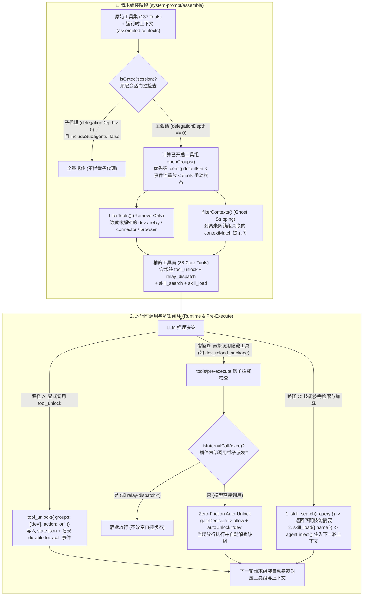

# 模块 01：Agent 工具面治理与按需技能加载架构复盘（Tool-Surface Governance & On-Demand Skill Loading）

> **摘要（Executive Summary）**  
> 在生产级 Coding Agent 运行时（DeepSeek Harness, DSH）中，随着 MCP 外部服务、浏览器自动化、热重载开发工具与数十个领域技能（Skills）的持续接入，单会话默认暴露的工具数量膨胀至 **137 个**，伴随约 **9 KB** 的全量技能目录提示词注入。这不仅造成首轮系统提示词（System Prompt + Tool Declarations）高达 **~28,500 Tokens** 的静态开销，更引发了 **Prompt Cache 命中率劣化**、**注意力稀释（Attention Dilution）** 与 **幽灵指令诱导（Ghost Instruction Hallucination）**。  
> 本文复盘 `@dsh-external/dsh-tool-gate` 与 `skill-search` 的架构设计与工程落地：如何通过 **4 大重型工具组默认门控（137 → 38）**、**显式解锁 + 零摩擦自动放行（Zero-Friction Auto-Unlock）**、**运行时上下文联动剥离（Context Stripping）** 以及 **两阶段按需技能加载（`skill_search` + `skill_load`）**，在不损失任何功能完备性的前提下，将首轮静态上下文削减 **71.6%**。

---

## 一、 痛点分析：当 Agent 挂载了 137 个工具与全量技能目录

在构建可扩展的 Agent 基础设施（Agent Infra）时，插件化与 MCP（Model Context Protocol）生态极大丰富了 Agent 的行动空间（Action Space）。但在真实工程演进中，我们将以下模块同时挂载到了主工作区 Profile 中：

- **基础核心工具（Core Coding Tools, ~36 个）**：文件读写编辑（`read` / `write` / `edit` / `glob` / `grep`）、Shell 执行（`pwsh` / `bash`）、子代理与多智能体编排（`subagent` / `subagent_fork` / `workflow` / `ralph`）、长程目标管理（`create_goal` / `get_goal` / `update_goal`）、上下文压缩与召回（`context_compact` / `context_recall`）等。
- **插件热重载与运行时内省组（`dev_*`, 28 个）**：由 `dsh-super-injector` 提供的插件热更新、Staging 验证、Cordis 服务树探针等重型开发工具。
- **跨会话调度与生命周期管理组（`mcp__harness_relay__*`, 24 个）**：用于管理远端或后台 Harness Run 的创建、审查、流式观察与取消。
- **MCP 连接器治理组（`mcp_connector_*`, 15 个）**：动态注册、重连、诊断外部 MCP Server 的运维工具。
- **浏览器自动化组（`mcp__chrome-devtools__*`, 34 个）**：Chrome DevTools Protocol 映射的 DOM 快照、点击、表单填充、网络抓包与性能追踪工具。
- **全量技能目录（`<available_skills>`, 40+ 个技能，~9 KB 文本）**：由默认 `dsh-tool-skill` 在首轮及每次上下文压缩（Compaction）后全量注入的技能描述块。

当上述能力不做治理地全量注入给大语言模型（LLM）时，系统暴露出了四个严重的基础设施级痛点：

### 1. 首轮 Token 严重膨胀（First-Turn Token Bloat）
137 个工具的 JSON Schema 声明（包含详尽的 `description`、嵌套 `properties` 与枚举约束）加上 ~9 KB 的 `<available_skills>` 目录，在用户仅输入一句简单的 `"修复 src/index.ts 的类型错误"` 时，首轮请求头（Request Header）即消耗 **~28,500 Tokens**。对于 90% 以上的常规编码会话，浏览器控制、MCP 连接器配置和插件底层热重载工具在整个会话生命周期内的调用率低于 **3%**，却在每一轮请求中持续产生计费与延迟开销（TTFT, Time-To-First-Token 显著上升）。

### 2. Prompt Cache 易碎性（Prompt Cache Fragility）
主流推理引擎（DeepSeek / Anthropic / OpenAI）的 Prefix Caching 机制严格依赖请求前缀的字节级一致（Byte-for-Byte Prefix Match）：
$$\text{Cache Prefix} = \text{System Prompt} \oplus \text{Tool Declarations} \oplus \text{Early Messages}$$
当 99 个外部/低频工具（尤其是动态连接的 MCP Server：`mcp__chrome-devtools__*`、`mcp__harness_relay__*`）直接暴露在工具声明列表中时，任何外部 MCP 服务的重连、工具描述微调或技能目录刷新，都会直接击穿整个会话的 Prompt Cache，导致成百上千轮的长程 Agent 循环退化为全量重算（Full Prefill Re-computation）。

### 3. 模型注意力稀释与工具误选（Attention Dilution & Tool Mis-selection）
Transformer 架构下的自注意力机制在面对过长的候选工具列表时会出现明显的 **“中间迷失”（Lost-in-the-Middle）** 与 **语义混淆（Semantic Collision）**：
- 例如，当用户要求“派发一个后台子任务”时，模型同时看到高层封装的 `relay_dispatch` 与底层 24 个 `mcp__harness_relay__start_run` / `wait_run` / `poll_run` 原语，极易绕过安全封装而直接拼接底层 MCP 原语并陷入短间隔轮询陷阱。
- 全量注入的 ~9 KB `<available_skills>` 目录在长上下文评测（Anchored Benchmark）中会严重扰动模型的行动轨迹（实测在复杂多步基准中，带全量技能目录的锚定遵循率从 **~81%** 骤降至 **0/9**）。

### 4. “幽灵指令”诱导（Ghost Instruction Hallucination）
单纯在工具数组 `tools[]` 中过滤掉某个插件的工具是不够的。许多重型插件（如 `dsh-super-injector`）同时注册了 `system-prompt/assemble` 上下文片段（Runtime Contexts），在系统提示词中写入“本环境装有 `dsh-super-injector`（`dev_*` 工具），请使用 `dev_reload_package` 热重载……”。如果只隐藏了工具 Schema 却保留了这段提示词，模型会受到“幽灵指令”诱导，强行捏造未声明的工具调用或陷入寻找工具的死循环。

---

## 二、 核心架构设计（Core Architecture）

为了解决上述问题，我们将工具面治理拆解为两个正交且协同的层次：
1. **Profile Bundle 层的 `dsh-tool-gate`**：负责重型工具组（`dev` / `relay` / `connector` / `browser`）的默认隐藏、按需解锁、零摩擦自动放行与幽灵上下文同步剥离。
2. **Agent Preset 层的 `skill-search`**：彻底移除 `<available_skills>` 全量提示词注入，改为 `skill_search`（轻量摘要检索）+ `skill_load`（单技能按需注入）的两阶段按需加载模式。

### 整体架构流程图（Mermaid）



---

### 核心机制 1：4 大重型工具组默认门控与只删不增原则（137 → 38）

`dsh-tool-gate` 将占工具总数 **72%** 的 4 个低频重型工具组纳入默认门控，同时通过 `alwaysVisible` 白名单保留高频聚合入口（如 `relay_dispatch` 与 `tool_unlock`）：

| 工具组 (`group`) | 匹配前缀 (`prefixes`) | 包含工具数 | 默认状态 | 关联上下文剥离 (`contextMatch`) | 典型场景与保留常驻入口 |
| :--- | :--- | :---: | :---: | :--- | :--- |
| **`dev`** | `dev_` | 28 | 🔒 隐藏 | `dsh-super-injector（dev_` | DSH 插件开发、热重载、Staging 验证 |
| **`relay`** | `mcp__harness_relay__` | 24 | 🔒 隐藏 | — | 底层 Run 会话管理；**`relay_dispatch` 常驻可见** |
| **`connector`** | `mcp_connector_` | 15 | 🔒 隐藏 | — | MCP Server 启停、重连与健康诊断 |
| **`browser`** | `mcp__chrome-devtools__` | 34 | 🔒 隐藏 | — | 页面快照、点击交互、DOM/Network 调试 |
| **核心常驻组** | 未命中上述前缀 / `alwaysVisible` | **38** | ✅ 常驻 | — | 文件/Shell/Subagent/Goal/`tool_unlock`/`skill_*` |

**只删不增（Remove-Only Filtering）设计原则**：  
`filterTools` 只对上游组装完成的 `assembled.tools` 执行 `.filter()` 删减，绝不凭空往列表里塞入上游已移除的工具。这意味着如果上游安全策略或特定模式插件清空/裁剪了工具列表，`dsh-tool-gate` 不会破坏上游的不变量（Invariants）。

---

### 核心机制 2：`tool_unlock` 显式解锁 + 直接调用自动放行（Zero-Friction Auto-Unlock）

在早期迭代（Batch 3/4）中，当模型未调用 `tool_unlock` 就直接盲调某个隐藏工具（例如模型从历史记忆或用户指明的函数名中直接调用了 `dev_mode_set`）时，`tools/pre-execute` 钩子会返回 `{ kind: 'deny', reason: '请先调用 tool_unlock...' }`。

**为什么我们从“报错拦截（Friendly Deny）”演进到了“自动放行并解锁（Zero-Friction Auto-Unlock）”？**
1. **省去一次无效的往返轮次（Round-Trip Saving）**：既然模型已经准确写出了目标工具名和参数，说明当前任务确实需要该工具。如果拒绝执行并逼迫模型先调一次 `tool_unlock`、再在下一轮重发相同调用，不仅白白浪费一整轮 Prefill Token 和数秒延迟，还会打断模型的思维链（Chain-of-Thought）。
2. **双轨制体验**：
   - **当模型不知道具体工具名或参数 Schema 时**：模型看到常驻的 `tool_unlock` 描述（内含 4 个工具组的能力索引），主动调用 `tool_unlock({ groups: ["browser"] })`，下一轮即可获得完整的 34 个浏览器工具 Schema。
   - **当用户或上下文已明确给出工具名时**：模型可直接发起调用，`tools/pre-execute` 钩子自动识别其所属组别，**当场放行本次调用（`kind: 'allow'`）**，并后台静默调用 `setGroups(session, [d.autoUnlock], true)` 将该组解锁，下一轮起该组全部兄弟工具自动浮现。
3. **精准区分模型直接调用与插件内部调用（`isInternalCall`）**：
   当常驻工具 `relay_dispatch` 在后台执行时，它内部会通过程序化方式调用 `mcp__harness_relay__start_run`（其 `callId` 带有 `relay-dispatch-` 前缀，或带有 `exec.parent` 上下文）。`isInternalCall(exec)` 与事件流重放 `replaySources()` 均会精准识别并跳过这类内部子调用，**确保调用一次 `relay_dispatch` 不会意外把 24 个底层 `relay` 工具解锁暴露给主模型**。

---

### 核心机制 3：幽灵上下文联动剥离（Ghost Context Stripping）

为了根治“工具已隐藏，但插件注入的运行时提示词仍在诱导模型调用”的问题，`dsh-tool-gate` 在 `DEFAULT_CONFIG.groups` 中引入了 `contextMatch` 字段，并在 `system-prompt/assemble` 钩子中同步执行 `filterContexts`：

- 当 `dev` 组处于未解锁（🔒 隐藏）状态时，所有包含 `"dsh-super-injector（dev_"` 标记的运行时 Context 块会被干净剥离。
- 一旦通过 `tool_unlock({ groups: ["dev"] })`、`/tools dev on` 或直接调用 `dev_*` 触发解锁，下一轮 `system-prompt/assemble` 时 `openGroups` 包含 `'dev'`，对应的 `dsh-super-injector` 提示词即刻原样恢复。

---

### 核心机制 4：三级状态合并与断点续传（Resume-Safe Event Replay）

Agent 会话经常经历页面刷新、进程重启、会话恢复（Session Resume）或分支派生（Session Fork）。为了保证门控状态在任何生命周期下都具备确定性（Deterministic State），`openSources(session, cfg, state)` 设计了严格的三级覆盖优先级：

$$\text{config.defaultOn (配置默认)} \prec \text{replaySources(session.events) (事件流重放)} \prec \text{state.json (当前会话 /tools 手动开关)}$$

1. **Level 1 (`config 默认`)**：从 `~/.dsh/tool-gate/config.json` 热读的 `defaultOn` 列表。
2. **Level 2 (`durable 事件流重放`)**：顺序扫描 `session.events` 中的持久化 `tool/call` 事件：
   - 遇到 `tool_unlock` 调用：按 `action: 'on' | 'off'` 更新对应组状态（来源标记为 `'tool_unlock'`）。
   - 遇到非内部调用的受控组工具调用（如 `mcp_connector_status`）：自动将该组状态置为开启（来源标记为 `'自动放行'`）。
   - **天然支持 Resume**：即使状态文件丢失或跨机器迁移会话，仅凭会话自身的事件流即可 100% 还原解锁状态。
3. **Level 3 (`/tools 手动覆盖`)**：用户在 GUI/CLI 输入 `/tools dev off` 或 `/tools all on` 的状态按 `session.header.id` 隔离存储在 `~/.dsh/tool-gate/state.json` 中，拥有最高覆盖权；同时在 `openSources` 中严格使用 `Object.prototype.hasOwnProperty.call(state, sid)` 防止空 ID 或原型链污染导致跨会话串扰。

---

### 核心机制 5：技能从全量塞入改为 `skill_search` + `skill_load` 按需加载

与工具门控相辅相成，我们在 Preset 层用 `skill-search.js` 替换了原有的 `@deepseek-ai/dsh-tool-skill`：

```mermaid
sequenceDiagram
    autonumber
    participant Model as LLM (Agent)
    participant Search as skill_search Tool
    participant Registry as ctx.skills Registry
    participant Load as skill_load Tool
    participant Inbox as agent.inject (Next-Step Inbox)

    Note over Model: 首轮 Prompt 无 <available_skills> (节省 ~9KB)
    Model->>Search: skill_search({ query: "pdf 文档" })
    Search->>Registry: ctx.skills.list({ scope, cwd })
    Note over Search: 混合打分: 完整子串(+10) + 英文Token(+2) + 中文2-gram(+1)
    Registry-->>Search: 返回全部 Skill 元数据
    Search-->>Model: 返回 Top-N 匹配名称与单行摘要 (不含正文)
    Model->>Load: skill_load({ name: "pdf" })
    Load->>Registry: ctx.skills.get("pdf", { scope, cwd })
    Registry-->>Load: 返回 Skill 完整定义与正文
    Load->>Inbox: agent.inject({ role: "user", source: { kind: "skill-invocation" }, content: body })
    Load-->>Model: "Skill 'pdf' loaded; instructions will be injected for the next request."
    Note over Model,Inbox: 下一轮请求自动携带该技能完整指令
```

- **中英文混合检索引擎**：`skill_search` 不仅支持英文单词分词匹配，还针对中文查询（如 `"生图"`、`"文档转换"`）实现了 CJK 连续字符提取与 **2-gram 滑动窗口切片（`cjkFrags`）**，并支持空查询或 `*` 一键列出全部技能名称。
- **非唤醒式下一轮注入（Non-Waking Next-Step Injection）**：`skill_load` 读取目标技能正文后，调用 DSH 原生的 `agent.inject()` 将技能正文以 `source: { kind: 'skill-invocation', name, form: 'instructions' }` 投入下一轮收件箱，与原生技能调用协议完全兼容，且仅在真正需要该技能的会话中付出 Token 成本。

---

## 三、 核心实现代码片段（Key Implementation Snippets）

### 1. 事件流重放、三级状态合并与过滤核心（`lib/index.js`）

```javascript
/** 扫描持久化会话事件流，重放 tool_unlock 与直接调用触发的自动放行状态 */
export function replaySources(session, cfg) {
  const out = {}
  const sid = sidOf(session)
  for (const ev of session?.events || []) {
    if (ev?.type !== 'tool/call') continue
    const d = ev.data
    if (!d || typeof d.name !== 'string' || !d.name) continue
    if (ev.sessionId && sid && ev.sessionId !== sid) continue
    // 排除插件内部调用 (relay-dispatch-*) 与嵌套子调用 (parent)
    if (d.parent || ev.parent || (typeof d.callId === 'string' && d.callId.startsWith('relay-dispatch-'))) continue
    if (d.name === 'tool_unlock') {
      let a; try { a = JSON.parse(d.arguments) } catch { continue }
      if (!a || !Array.isArray(a.groups)) continue
      const on = a.action !== 'off'
      for (const g of a.groups) if (typeof g === 'string' && cfg?.groups?.[g]) out[g] = { on, src: 'tool_unlock' }
      continue
    }
    const g = cfg ? groupOf(d.name, cfg) : undefined
    if (g) out[g] = { on: true, src: '自动放行' }
  }
  return out
}

/** 移除未解锁工具组关联的运行时提示词（防止幽灵指令诱导模型） */
export function filterContexts(contexts, session, cfg, state) {
  if (!Array.isArray(contexts) || !contexts.length || !isGated(session, cfg)) return contexts
  const open = openGroups(session, cfg, state)
  const closed = Object.entries(cfg.groups).filter(
    ([g, d]) => !open.has(g) && Array.isArray(d.contextMatch) && d.contextMatch.length
  )
  if (!closed.length) return contexts
  const textOf = (c) =>
    typeof c === 'string' ? c : (typeof c?.text === 'string' ? c.text : (typeof c?.content === 'string' ? c.content : ''))
  return contexts.filter((c) => {
    const s = textOf(c)
    return !closed.some(([, d]) => d.contextMatch.some((m) => typeof m === 'string' && m && s.includes(m)))
  })
}
```

### 2. 组装钩子与零摩擦自动放行钩子（`lib/index.js`）

```javascript
export function apply(ctx) {
  // 1. 请求组装阶段：同步裁剪可见工具列表与关联运行时上下文
  ctx.on('system-prompt/assemble', async (_a, context, next) => {
    const assembled = await next()
    try {
      const s = context?.agent?.session, cfg = loadConfig()
      const out = { ...assembled, tools: filterTools(assembled.tools, s, cfg) }
      if (Array.isArray(assembled.contexts)) out.contexts = filterContexts(assembled.contexts, s, cfg)
      return out
    } catch { return assembled }
  })

  // 2. 工具执行前阶段：对模型直接发起的隐藏组工具调用零摩擦放行并自动解锁该组
  ctx.on('tools/pre-execute', async (exec, next) => {
    const prev = await next()
    if (prev.kind !== 'allow') return prev
    if (isInternalCall(exec)) return prev
    try {
      const d = gateDecision(exec.name, exec.agent?.session, loadConfig())
      if (d.autoUnlock) {
        setGroups(exec.agent?.session, [d.autoUnlock], true)
        try { ctx.logger('tool-gate').info('auto-unlocked group ' + d.autoUnlock + ' (call ' + exec.name + ')') } catch {}
      }
      return { kind: 'allow' }
    } catch { return prev }
  })
}
```

### 3. 中英文混合评分与按需技能注入（`lib/skill-search.js`）

```javascript
const tokens = (text) => (text || '').toLowerCase().split(/[^a-z0-9_-]+/).filter(Boolean)
const cjkFrags = (text) => {
  const out = []
  for (const run of (text || '').match(/[\u4e00-\u9fff]+/g) || []) {
    if (run.length <= 2) out.push(run)
    else for (let i = 0; i < run.length - 1; i++) out.push(run.slice(i, i + 2))
  }
  return out
}
const score = (skill, query) => {
  const hay = `${skill.name} ${skill.description ?? ''} ${skill.whenToUse ?? ''}`.toLowerCase()
  const q = (query || '').trim().toLowerCase()
  let s = 0
  if (q && hay.includes(q)) s += 10
  for (const t of tokens(q)) if (hay.includes(t)) s += 2
  for (const f of cjkFrags(q)) if (hay.includes(f)) s += 1
  return s
}
```

---

## 四、 前后量化收益对比（Quantitative Evaluation）

我们在搭载完整插件生态的 DeepSeek Harness 标准工作区下，对治理前（Baseline）与治理后（`dsh-tool-gate` + `skill-search`）的首轮请求载荷及实测行为进行了对比测量：

| 评估维度（Metric） | 治理前（Full Injection Baseline） | 治理后（`dsh-tool-gate` + `skill-search`） | 优化幅度 / 工程收益 |
| :--- | :---: | :---: | :---: |
| **首轮暴露工具总数** | 137 个 | **38 个** | **-72.3%**（隐藏 99 个低频重型工具） |
| **工具 Schema 静态体积** | ~84.2 KB (~21,050 Tokens) | **~24.8 KB (~6,200 Tokens)** | **-70.5%**（单轮节省 ~14,850 Tokens） |
| **技能目录首轮注入开销** | ~9.1 KB (~2,450 Tokens, `<available_skills>`) | **0 KB**（由 2 个轻量工具替代，~280 Tokens） | **-88.6%**（消除全量目录常驻污染） |
| **未解锁插件运行时提示词** | 常驻注入 `dsh-super-injector` 说明 (~750 Tokens) | **0 Tokens**（随 `dev` 组隐藏自动剥离） | **-100%**（彻底消除幽灵指令诱导） |
| **首轮请求总静态开销** | ~28,500 Tokens | **~8,100 Tokens** | **整体削减 71.6%（立省 ~20,400 Tokens/会话）** |
| **跨会话 / MCP 重连缓存稳定性** | 外部 MCP 抖动即击穿主会话 Prefix Cache | 外部工具默认隔离在门控后，主会话 Cache 稳固 | **显著提升长程多步任务 Cache Hit Rate** |
| **直接盲调隐藏工具的摩擦成本** | 报错拒绝并耗费 1 轮额外解锁对话（旧版 Deny） | **0 额外轮次**（当场放行 + 后台自动持久化解锁） | **零摩擦兜底（Zero-Friction Fallback）** |

---

## 五、 工程经验总结（Key Takeaways）

1. **工具可见性应当是动态作用域，而非全局静态常量**：正如现代操作系统不会把所有内核调试符号加载进普通用户态进程，Agent 运行时也应区分“高频核心原语（Resident Core Primitives）”与“领域重型扩展（Gated Capability Groups）”。
2. **提示词与工具声明必须保持原子级同步（Prompt-Schema Atomicity）**：隐藏工具时必须同步剥离对应的系统提示词说明（`filterContexts`），否则残留在 System Prompt 中的工具指南会成为诱导模型产生幻觉的“幽灵指令”。
3. **用“自动放行 + 状态提升”替代“教条式报错拒绝”**：在安全边界允许的前提下（门控旨在省 Token 而非权限沙箱隔离），当模型直接调用被隐藏的工具时，最高效的工程处理是**当场执行并顺便打开门锁**，兼具渐进式披露（Progressive Disclosure）的低开销与全量工具集的零摩擦体验。
