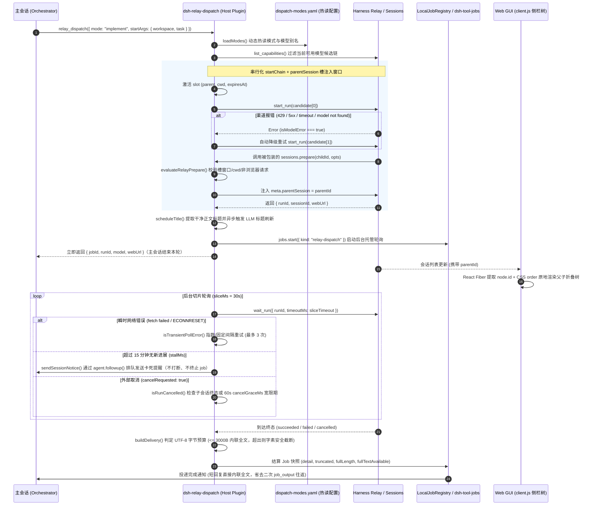
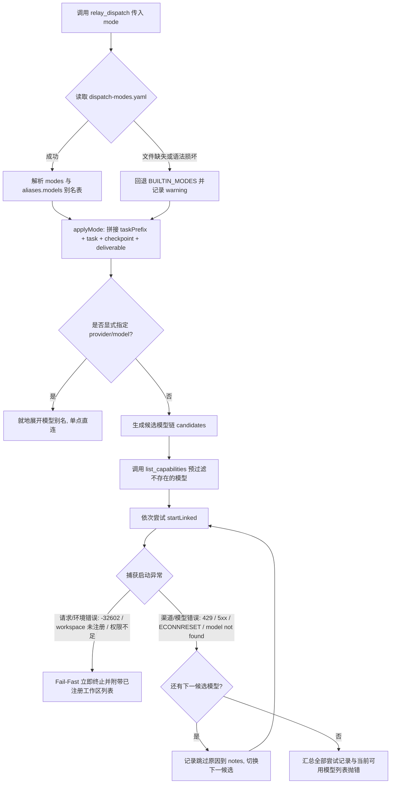
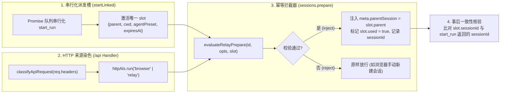
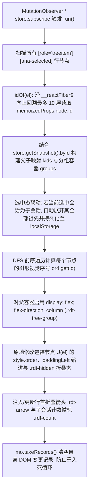

# 02. 异构多模型主从调度与零闪烁侧栏会话树（`dsh-relay-dispatch`）

> **模块定位**：面向长周期复杂软件工程任务的 **主从多智能体编排与跨厂商模型互审基础设施（Heterogeneous Multi-Agent Orchestration & Verification Infrastructure）**。  
> **核心代码**：`packages/dsh-relay-dispatch/lib/index.js`（宿主侧调度与通信内核）、`packages/dsh-relay-dispatch/lib/client.js`（Web GUI 侧栏会话树引擎）、`packages/dsh-relay-dispatch/test/unit.mjs`（全链路回归测试套件）。

---

## 1. 背景与核心痛点：为什么单体 Agent 在长周期工程中必然劣化？

在真实的复杂工程任务（如跨包重构、多模块排障、大型全栈特性交付）中，若让单个主会话（Monolithic Session）包揽“代码搜索 → 阅读成百上千行源码 → 修改实现 → 跑测试排错 → 代码自审”的全流程，会迅速撞上三重工程瓶颈：

1. **上下文污染与注意力稀释（Context Pollution）**：一次全量 `grep`、长测试日志或连续几次构建报错就会向主会话倾倒数万 Token 的瞬态噪音。随着轮次增长，KV Cache 体积暴涨，模型对最初架构约束与边界条件的遵循度急剧下降（Lost-in-the-Middle 效应）。
2. **同步轮询的 Token 空转黑洞（Polling Overhead）**：宿主原生的 `mcp__harness_relay__start_run` 与 `wait_run` 是分离的原语。若主会话自行循环调用 `wait_run` 轮询子任务，每次短超时返回都会触发一整轮携带完整上下文的 LLM 推理请求，不仅燃烧大量 Token，还阻塞了主会话并行推进其他独立步骤的能力。
3. **同模型自审的同源盲区（Homogeneous Blind Spots）**：让同一个模型（或同厂商同家族模型）既当运动员（Implementer）又当裁判员（Reviewer/Verifier），往往会对自己生成的隐蔽竞态、正则边界漏判或幻觉 API 视而不见。
4. **可观测性割裂（Observability Gap）**：Relay 启动的子会话在宿主中默认作为平级顶层会话创建，缺少 `parentSession` 关联；当一次任务派生出 5~10 个子会话时，Web GUI 侧栏会被平铺的会话淹没，无法直观追踪主从拓扑。

`@dsh-external/dsh-relay-dispatch` 正是为了系统性解决上述四大痛点而设计的纯 JS、零运行时外部依赖插件。

---

## 2. 架构设计：轻量化主程（Orchestrator）与子会话上下文隔离

### 2.1 核心职责解耦：Orchestrator vs. Worker

在 `dsh-relay-dispatch` 架构下，主会话被严格约束为 **轻量化主程（Lightweight Orchestrator）**，而繁重的执行过程全部下沉到独立的 **Fresh Worker 子会话**：

- **主程（Orchestrator）只做三件事**：
  1. **任务拆解与边界定义**：明确目标文件范围、约束条件（`taskPrefix`）与验收标准（`deliverable`）。
  2. **非阻塞异步派发**：调用 `relay_dispatch({ mode, startArgs: { workspace, task } })`，立即取得 `runId`、`jobId` 与子会话 `webUrl`，随即结束当前轮次（零轮询等待）或并行处理无依赖工作。
  3. **关键证据抽查（Spot-check Verification）**：收到完成通知后，主程不读取子任务长达数十轮的中间探索过程，仅审阅结构化结论摘要（`status / changed_files / verification / risks / summary`），并抽查关键证据（如执行一次单元测试或 `git diff --stat`）。
- **子会话（Worker）独立上下文隔离**：
  - 每次派发默认注入 `sessionMode: 'fresh'`，在全新上下文中启动，天然隔绝主会话的历史包袱。
  - 根据任务性质自动收紧权限沙箱：调查与验证模式（`investigate` / `verify` / `review`）强制 `read-only`；实现模式（`implement` / `heavy`）自动配齐 `writeScope: [workspace]` 与权限确认标记。

### 2.2 全链路架构与生命周期时序图



---

## 3. 异构模型交叉验证（Heterogeneous Verification）与模式化候选链

### 3.1 为什么“同模型自审”会共享盲区？

在大语言模型工程实践中，若使用同一模型家族（例如用 Gemini 编写复杂状态机代码，再开启另一个 Gemini 会话执行 `review` 或 `verify`），会出现显著的 **同源归纳偏置（Homogeneous Inductive Bias）**：

1. **共享训练分布与API幻觉**：同一模型对特定库版本、冷门 Node.js API 或边缘语法的认知偏差是高度一致的。写代码时误用的参数签名，在自审时往往被同一套内部表征判定为“合理”。
2. **对称的注意力盲点**：某些模型擅长宏观长文本连贯性与快速骨架生成，但在隐式类型转换、异步清理重入（Re-entrancy）或幂等释放锁等微观细节上容易跳步；当它作为 Reviewer 阅读同类代码时，同样会滑过这些微观路径。
3. **测试构造的同构性**：同模型生成的单元测试往往沿着其生成实现时的正向思维路径编写（Happy-path confirming tests），极难构造出能击穿自身实现假设的对抗性边界用例（Adversarial Edge Cases）。

因此，高可靠 Agent 基础设施必须引入 **跨厂商异构交叉验证（Cross-Family Heterogeneous Verification）**：
- **实现层（`implement`）**：优先选用代码局部严密性高、工具调用稳健的模型（如 `copilot/claude-sonnet-5.5`、`openai/gpt-5.3-codex`）。
- **验证与审查层（`verify` / `review`）**：切换到不同厂商或更高推理深度的异构模型（如 `google/gemini-3.8-pro`、`cursor/claude-opus-5-5`），利用不同训练分布之间的正交性暴露盲区。
- **高频调查层（`investigate`）**：选用高吞吐、低延迟模型（如 `cursor/grok-4.7-fast`、`google/gemini-3.8-flash`），以极低成本完成代码库摸底。

### 3.2 热读模式引擎与智能故障降级链

`dsh-relay-dispatch` 在 `lib/index.js` 中内置了零依赖的极简 YAML 解析器 `parseModesYaml()`，每次调用 `relay_dispatch` 时实时热读 `~/.dsh/dispatch-modes.yaml`：



**关键工程细节**：
- **严格区分“渠道故障”与“调用方参数错误”（`isModelError`）**：并非所有报错都应该触发模型切换。若工作区未在 Harness 注册（`not registered in Harness`）、MCP 参数校验失败（`-32602`）或权限字段缺失，换再多模型也必然失败。`isModelError()` 严格识别 `429`、`rate limit`、`quota`、`500/502/503/504`、`ECONNRESET`、`model not found` 等渠道级异常才允许切换候选；遇到工作区错误时则主动调用 `list_workspaces` 将合法工作区路径拼接到报错信息中，帮助主会话一次性自愈。

---

## 4. 通信与可靠性工程：从 Token 压缩到防挂死自愈

### 4.1 完成通知内联截断与结构化交付协同（省去二次 `job_output` 往返）

在早期版本中，后台任务完成时宿主只会向主会话发送一句通用提示：`background job xxx finished. Read its output with job_output.`。这迫使主会话必须额外发起一次 `job_output` 工具调用才能看到子任务结论——每次派发白白多耗费一轮完整的 LLM 输入输出 Token。

为此，我们在 `lib/index.js` 中设计了 `buildDelivery(status, text, budget = 3000, fullTextAvailable = true)`，并与宿主 `dsh-tool-jobs` 的 `fitCompletionNotice` 实现了结构化契约协同：

1. **短结论零往返直达（`full_in_detail=1`）**：由于模式配置中的 `deliverable` 已约束子会话输出精简的 8~10 行结构化交付，绝大多数子任务结论远小于 `DETAIL_BUDGET_BYTES`（3000 UTF-8 字节）。此时 `buildDelivery` 生成带 `full_in_detail=1` 标记的完整正文，`truncated: false`，完成通知直接内联全部结论，并且**自动抑制冗余的 `Read its output with job_output` 提示**，实现“通知即交付”。
2. **长结论 UTF-8 字素安全截断（`truncated=1`）**：当子会话返回超长报告时，直接使用 `String.prototype.slice` 极易按 UTF-16 码元切碎代理对（Surrogate Pairs，产生 `\uD800` 等非法孤立半码元导致 JSON 序列化或下游 API 报错）或切碎组合字素簇（如带重音符号的拉丁字母 `e\u0301`、复杂 Emoji）。`truncateUtf8(text, maxBytes)` 优先使用 `Intl.Segmenter(undefined, { granularity: 'grapheme' })` 按完整字素簇累加 UTF-8 字节预算，在头部明确标注 `truncated=1 full_length=... chars` 并给出包含精确 `job_id` 的 `job_output` 读取指引，同时完整原文仍无损保留在后台 Job 的 `readOutput` 缓冲区中。

### 4.2 15 分钟多源停滞检测与非侵入式 `followup` 提醒

长耗时子任务可能因为某个 `pwsh` 命令等待交互输入或外部子进程死锁而陷入静默停滞。需要注意的是，Relay 自身在 `runStallMs` 超时后会将状态标为 `status: 'needs_attention', attentionReason: 'run_stalled'`，但**此时子会话仍在运行，并非终态**（`isTerminalSnap` 专门排除了未带 `finishedAt` 的 `run_stalled` 状态，防止误杀后台 Job）。

为了在不误杀慢任务的前提下让主会话掌控全局，后台轮询实现了精细的停滞检测状态机：
- **五维进展融合判定**：同时比对 Relay 快照的 `lastEventSeq`、`assistantText.length`、`lastProgressAt/updatedAt` 以及宿主内存中子会话对象的 `childSession.events.length` 与最新事件时间戳（`getLatestSessionEventTime`）。任一维度前进即视为有实质进展（`progressed = true`）。
- **精准定位卡点工具（`extractLastToolName`）**：一旦无进展时长达到 `stallMinutes`（默认 15 分钟），插件逆序扫描子会话事件流（兼容 `tool/call`、`assistant/message` 中的 `tool-call/tool_use` 块以及 `assistant/chunk` 中的 `tool-call-delta`），提取出子会话最后调用的工具名称（例如 `pwsh`）。
- **单周期去重与恢复重置**：同一停滞周期只发送一次提醒（`stallNotified = true`）；若子会话随后恢复进展（产生新事件），自动重置 `stallNotified = false`，若后续再次卡死仍可二次告警。
- **为什么坚持走 `followup` 而不是 `inject`？**（`sendSessionNotice`）：如果主会话此时正处于 `busy` 状态（例如正在执行另一项复杂推理或工具调用），调用 `agent.inject()` 会强行插话打断主会话当前的思维链；而统一调用 `agent.followup(message)` 则会将提醒安全放入队列，待主会话当前轮次自然结束后再优雅唤醒。

### 4.3 取消宽限期（`cancelGraceMs`）防挂死与轮询瞬时容错

- **取消宽限期防死等**：当用户或主会话取消任务时，Relay 快照会变为 `cancelRequested: true`。但如果子会话正卡在一个不可中断的同步/长耗时工具调用中，Relay 的 `status` 会一直停留在 `running`。若死等 `status === 'cancelled'`，后台 Job 会一直挂起到 `maxWaitMinutes`（240 分钟）才超时。`isRunCancelled()` 采用三级判定：
  1. `snap.status === 'cancelled'` → 立即按取消收口；
  2. `snap.cancelRequested === true` 且检测到子会话已终止（`isChildSessionTerminated` 发现宿主 `childAgent.status === 'idle'` 或最新一轮 `turn/end` 序号大于 `turn/start`）→ **零等待立即收口**；
  3. `snap.cancelRequested === true` 但子会话迟迟不退出 → 启动 `cancelGraceMs`（默认 60 秒）倒计时，动态收窄 `sliceTimeout`，满 60 秒未终止即强制按 `cancelled` 结束后台 Job，并保留已输出的半截 `assistantText`。
- **轮询瞬时错误重试（`isTransientPollError`）**：长达数小时的后台等待中，本地回环或 MCP 通道偶发 `fetch failed`、`ECONNRESET`、`socket hang up` 或 `502/503/504`。轮询内层循环对此类瞬时错误最多连续重试 `waitMaxRetries`（默认 3 次，间隔 `2000ms`），重试期间随时响应 `abort.signal`，彻底消除因单次网络抖动导致长任务前功尽弃的问题。

---

## 5. 宿主逆向与可观测性 UX：无侵入父子会话关联与零闪烁侧栏树

### 5.1 宿主逆向：用 `Symbol.for` + `generation` 代数锁幂等注入 `parentSession`

DSH 的会话存储层原生支持 `header.parentSession` 字段，但 `mcp__harness_relay__start_run` 的工具 Schema 锁死了入参，不允许外部传入 `parentSession`。为了让 `relay_dispatch` 创建的所有子会话自动挂载到发起派发的主会话名下，我们在宿主内存服务层实施了精巧的拦截与注入：



这一机制攻克了四个极具挑战性的工程边界问题：

1. **防止跨异步边界丢失上下文**：Relay 创建会话既可能走同进程 RPC（经 `setTimeout` 宏任务或内部队列切换导致 `AsyncLocalStorage` 丢失），也可能走本地 HTTP `/api` 回环，还会由宿主自动补全默认 `meta.agentPreset = 'standard'`。因此 `evaluateRelayPrepare()` 不强依赖 `dispatchAls` 命中，而是基于 **串行化时间窗口槽（`slot`）+ 工作区路径匹配（`cwdMatch`）+ 排除浏览器手动请求（`reqKind !== 'browser'`）+ 可选 `agentPreset` 匹配** 进行综合判定。
2. **防用户在派发瞬间手动新建会话“抢槽”**：通过包装 `webServer.prefixes.get('/api').handler`，利用 `classifyApiRequest(req.headers)` 检查 `Origin`、`Referer`、`Sec-Fetch-Site`、`User-Agent` 与 `x-dsh-relay-principal`。若用户在 `start_run` 执行窗口内恰好在浏览器点击“新建同工作区会话”，请求会被染色为 `'browser'` 并被 `evaluateRelayPrepare` 明确拒绝（`reason: 'browser_request'`），绝不会抢占 Relay 的 `slot`。
3. **事后 `sessionId` 一致性校验**：`start_run` 返回后，立即核对 `slot.sessionId`（被注入的会话 ID）与 `started.sessionId`（Relay 实际返回的会话 ID）。若发生极端异常导致不一致，立即发出告警并跳过标题改写，绝不污染无辜会话。
4. **防热重载 Wrapper 链式叠加与旧实例 `dispose` 误拆（`Symbol.for` + `generation`）**：在插件开发热重载（`dev_reload`）时，`apply(ctx)` 会被多次调用，且旧插件实例的 `dispose` 清理函数有时会在新实例挂载**之后**才触发。我们在 `sessions` 服务实例上挂载全局符号 `sess[Symbol.for('relay-dispatch.prepare')] = { orig, generation }`：
   - 每次 `apply` 时先将 `sess.prepare` 还原为最底层的 `orig`，再递增 `generation` 并安装新包装函数，确保任何时候底层 `orig` 只被包装一层（无链式叠加开销）；
   - `ctx.effect` 注册的 `dispose` 回调仅在 `sess[PREPARE_SYM].generation === myGen` 时才还原 `sess.prepare = orig`，彻底杜绝旧实例滞后卸载拆掉新实例钩子的竞态 Bug。

### 5.2 前端可观测性 UX：React Fiber 逆向提取 + CSS `order` 零闪烁侧栏会话树

当 `parentSession` 成功写入后端后，Web GUI 的 `ctx.sessions.list` 快照中每个子会话条目会携带 `parentId`。然而，DSH 官方前端侧栏组件将所有会话渲染为平铺列表（Flat List），且 DOM 节点上**没有任何 `data-session-id` 属性**。如果在前端插件中强行使用 `appendChild` / `insertBefore` 移动会话行 DOM 节点，会立刻引发严重的生产事故：
- **破坏 React Virtual DOM 树结构**：React 在下次重渲染或卸载组件执行 `removeChild` 时会抛出 `NotFoundError: The node to be removed is not a child of this node`，直接导致整个 Web GUI 白屏崩溃。

为此，`lib/client.js` 采用了一套**完全不移动 React 托管 DOM 节点**的零闪烁原位成树方案：



---

## 6. 真实排障案例集（Production War Stories）

### 案例一：鼠标悬停侧栏引发的 `MutationObserver` 无限重排与闪烁死循环
- **故障现象**：侧栏会话树初版上线后，静态展示完全正常，但只要用户将鼠标悬停（Hover）在任意带子会话的侧栏条目上，子会话就会在父会话上方与下方之间高频跳动闪烁。
- **根因定位**：
  1. DSH 侧栏条目外层包了一层 Radix UI 的 `HoverCard` 触发器 `<span class="...">`，真正的 `<div role="treeitem">` 位于该 `<span>` 内部。因此 CSS `style.order` 必须设在外层包装器 `U(el)` 上才会在 Flex 容器中生效。
  2. 初版代码通过 `p.tagName === "SPAN" && p.children.length === 1` 来识别外层包装器 `U(el)`。
  3. 当鼠标悬停触发 `HoverCard` 展开时，Radix UI 会在该外层 `<span>` 内动态追加一个 `<span role="status">` 辅助无障碍节点，导致 `p.children.length` 从 `1` 变成 `2`！
  4. `U(el)` 判定瞬间失效，退回内层 `<div role="treeitem">`，代码把外层 `<span>` 上的 `style.order` 清空并写到了内层 `<div>` 上，导致该行在 Flex 容器中瞬间失去排序权重跳回原位；而位置跳动导致鼠标移出 `HoverCard` 销毁 `role="status"` 节点，`children.length` 变回 `1`，再次触发重排——形成经典的 **DOM 变更 → 布局跳变 → 悬停丢失 → DOM 变更** 振荡死循环。
- **修复方案**（见 `lib/client.js:45`）：摒弃脆弱的 `children.length === 1` 计数判断，改为语义化特征判定：
  ```js
  const U = (el) => {
    const p = el.parentElement;
    return p && !p.hasAttribute("role") && p.tagName === "SPAN" ? p : el;
  };
  ```
  同时在 `MutationObserver` 的 `hasRowNode` 过滤器中仅监听包含 `[role="treeitem"][aria-selected]` 的节点增删，并在每次 `run()` 尾部调用 `mo.takeRecords()` 吞掉自身注入 `.rdt-arrow` / `.rdt-count` 产生的变更记录，彻底实现零闪烁。

### 案例二：同进程 Relay 脱离 `AsyncLocalStorage` + 默认 `agentPreset` 注入导致 `parentSession` 漏挂
- **故障现象**：在部分派发场景下，主会话并未显式传入 `agentPreset`（使用默认配置），结果子会话创建成功后在侧栏中依然显示为顶层独立会话，未能挂到主会话下方。
- **根因定位**：通过 `~/.dsh/relay-dispatch-parent.log` 诊断日志排查发现两处拦截过严：
  1. 当 Relay 走同进程内部调用时，中间经过了事件循环宏任务队列调度，`dispatchAls.getStore()` 与 `httpAls.getStore()` 均为 `undefined`；
  2. 派发时 `slot.agentPreset` 为 `undefined`，但宿主在调用 `sessions.prepare(id, opts)` 前自动将 `opts.meta.agentPreset` 填充为默认值 `'standard'`，初版严格相等校验 `meta.agentPreset === slot.agentPreset` 直接返回 `agentPreset_mismatch` 拒绝注入。
- **修复方案**（见 `lib/index.js:339-394`）：重构 `evaluateRelayPrepare()` 判定逻辑——仅当派发槽显式指定了 `s.agentPreset` 时才校验 `meta.agentPreset`；在 `slot` 处于有效时间窗口且 `cwdMatch` 命中、`meta.origin` 与 `meta.parentSession` 均为空时，采用“黑名单排除法”（只有明确识别为 `reqKind === 'browser'`、手动 initiator 或手动调用栈时才拒绝），并在每次 `prepare` 时向诊断日志输出完整的结构化判定原因（`slotStatus / cwdMatch / result / reason / parentSession`）。

### 案例三：带 `parentSession` 的子会话标题被通用禁令前缀污染
- **故障现象**：子会话挂载 `parentSession` 后，宿主不再对其执行首条消息自动摘要命名，或者直接截取首条消息前 40 个字符作为标题，导致侧栏里一排子会话全部叫 `通用禁令：不重启 DSH；不读 secrets...`，完全无法分辨各自的任务内容。
- **修复方案**（见 `lib/index.js:259-268, 739-791`）：实现 `cleanBodyTitle(rawTask, prefix)` 与 `scheduleTitle()` 双阶段标题调度：
  1. **立即兜底命名**：自动剥离模式注入的 `taskPrefix`、`通用禁令：...` 行以及 Markdown 标题符号（`#`、`*`、数字序号），提取干净的任务首行核心短语（UTF-8 字素截断至 40 字节内），在会话对象就绪后第一时间调用 `sessionTitle.rename(session, fallback)`；
  2. **异步 LLM 标题精炼**：待子会话产生首轮 `user/message` 与 `request/header` 事件后，调用一次带本地超时保护（`withLocalTimeout(..., 15000)`）的 `sessionTitle.refresh(session)`，并在插件 `dispose` 时自动取消所有未决轮询定时器，兼顾可读性与资源安全。

---

## 7. 工程验证与测试覆盖矩阵

`packages/dsh-relay-dispatch/test/unit.mjs` 构建了不依赖外部网络、可直接对接 DSH 核心组件（`cordis`、`LocalJobRegistry`、`dsh-tool-jobs`）的 11 大测试套件：

| 测试套件标识 | 覆盖的核心工程能力与边界条件 |
| :--- | :--- |
| `all ok` / `fill ok` | MCP 多形态返回解析（`parseResult`）、默认参数补全与危险权限自动确认（`fillStartArgs`） |
| `modes ok` | `parseModesYaml` 语法解析、`applyMode` 显式字段优先级、热读生效、文件损坏自动回退 `BUILTIN_MODES`、候选链跳过不存在模型与 429 自动故障转移 |
| `classify ok` | `isModelError` 精准区分渠道级异常（429/5xx/ECONNREFUSED）与请求级错误（-32602/workspace 未注册/隐藏工具组） |
| `tokopt ok` | `aliases.models` 别名映射展开、全部候选失败时自动拉取并回显当前可用模型清单 |
| `p0 ok` | `truncateUtf8` UTF-8 字节预算边界、代理对与组合字素（`🙂`、`e\u0301`）零损坏截断、`DETAIL_BUDGET_BYTES` 临界点判定 |
| `p2 ok` | `buildDelivery` 与宿主 `fitCompletionNotice`、`LocalJobRegistry`、`job_output` 端到端集成验证（短回复省去 `job_output` 往返，长回复预览+全文无损拉取） |
| `robust ok` | 浏览器同工作区并发手动建会话防抢槽、事后 `sessionId` 不一致告警防污染、多父会话并发派发 `startChain` 串行隔离、`start_run` 挂死超时自动释槽、`scheduleTitle` 超时与 `dispose` 取消 |
| `notify ok` | 直接取消、`cancelRequested: true` 卡工具调用满 60s `cancelGraceMs` 强制收口、子会话 `turn/end` 零等待收口、15 分钟停滞提醒单周期去重与恢复后二次提醒 |
| `parentfix ok` | `Symbol.for` + `generation` 多次挂载防 Wrapper 链式叠加、旧实例滞后 `dispose` 不拆新实例钩子、同进程无请求头 Relay 注入与结构化诊断日志校验 |
| `polish ok` | 主会话 `busy` 状态下停滞提醒强制走 `followup` 绝不调用 `inject`、后台 `wait_run` 连续 3 次瞬时网络错误重试恢复与第 4 次超限退出 |
