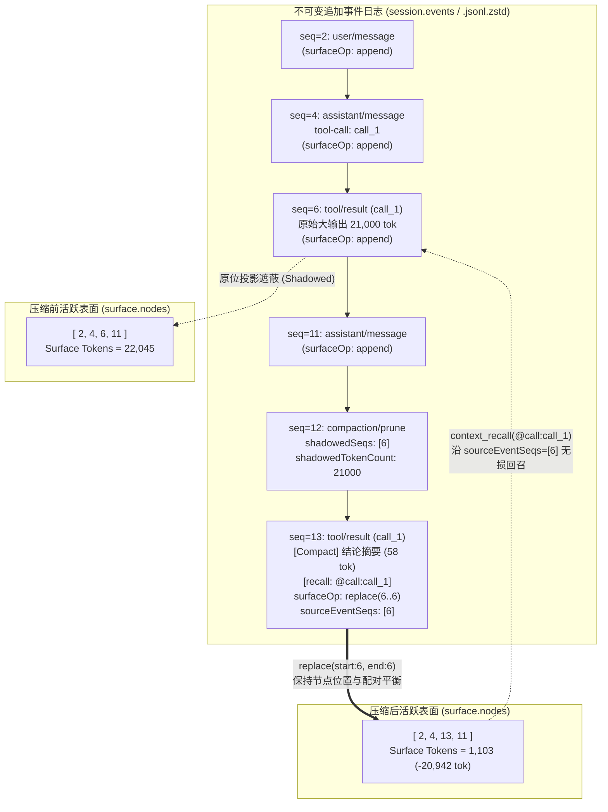
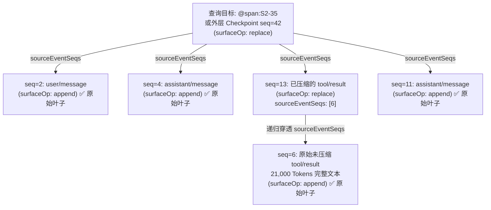

# 03. 事件流级无损精确上下文压缩：告别有损滚动摘要的 Agent 记忆手术刀 (`dsh-context-compact`)

> **模块定位**：`@dsh-external/dsh-context-compact`  
> **核心能力**：基于不可变追加事件日志（Append-only Event Log）与动态表面投影（Surface Projection）分离架构，实现单条工具结果（`results`）与跨轮连续区间（`spans`）双粒度无损精确上下文压缩（`context_compact`），以及基于 `sourceEventSeqs` 溯源 DAG 递归展开的正则/分页无损回召（`context_recall`）。

---

## 1. 痛点对比：为什么传统“全量滚动摘要”在 Coding Agent 中是灾难？

### 1.1 全量滚动摘要（Rolling Summary）的“结构性失忆”

在传统的 Coding Agent 架构中，上下文管理通常退化为一条简单的启发式规则：当会话 Token 逼近模型上下文窗口阈值（如 80%）时，将前半段或整段历史对话交给 LLM 做一次“全量滚动摘要（Rolling Summary）”，再用生成的几百字自然语言概括替换原消息数组。

这种做法在闲聊场景中尚可应付，但在严肃的软件工程与基础设施排障（Agent Infra）场景下，会直接引发**精确锚点坍塌（Anchor Collapse）**：

1. **行号与偏移量丢失**：摘要模型倾向于把 `src/session/store.ts:397-417` 概括为“检查了会话存储的校验逻辑”。当 Agent 在后续步骤需要调用 `edit` 或定点复查时，由于丢失了精确行号与函数签名，只能被迫重新 `grep` / `read`，陷入“压缩 → 失忆 → 重新读取 → 再次撑爆上下文”的死循环。
2. **符号名、错误码与 Hash 截断**：诸如 `ZSTD_error_prefix_unknown`、`ERR_INVALID_ARG_TYPE`、提交 SHA 或特定 `callId` 等高信息熵字面量，在全局自然语言改写中极易被泛化或遗漏。
3. **全盘破坏前缀 KV Cache（Prefix Cache Invalidation）**：全量滚动摘要一次性重写历史消息头部，导致推理引擎已缓存的数十万 Token KV Cache 瞬间全部失效，首字延迟（TTFT）与计费成本陡增。
4. **不可逆的信息销毁**：一旦原始消息在内存中被覆盖，被摘要抹平的底层细节便永久丢失，Agent 没有任何机制在需要时“翻看原卷”。

| 维度 | 传统全量滚动摘要（Rolling Summary） | 事件流级精确压缩（`dsh-context-compact`） |
| :--- | :--- | :--- |
| **操作粒度** | 粗粒度一刀切（整段历史轮次合并重写） | **双粒度手术刀**：单条工具返回（`results: callId`）+ 闭环历史轮次区间（`spans: turn:N..M`） |
| **触发与执刀者** | 阈值被动触发，由旁路摘要请求盲目概括 | **Agent 主动执刀**：在阶段调查收敛时自主提炼工程结论，精准保留路径、行号、符号与错误码 |
| **底层数据安全性** | 破坏性覆盖（Lossy Overwrite），原文不可找回 | **100% 无损（Lossless）**：底层 `.jsonl.zstd` 事件流只追加不删改，仅在 `surface.nodes` 做投影替换 |
| **按需回溯能力** | 无（只能重新执行工具或重新读文件） | **原生支持 `context_recall`**：通过 `@call` / `@span` 溯源标签递归展开叶子事件，支持正则过滤与行号分页 |
| **当轮推理连续性** | 立即截断当前上下文，打断多步推理链 | **Staged 延迟提交**：默认轮末（`agent/turn-stopping`）生效，本轮内原文保持可见；高占用或结轮时支持立即提交 |
| **KV Cache 友好度** | 头部全量重写，前缀 Cache 100% 失效 | 静态规则走 `systemPrompt.section`，单点原位替换最大化保留前后文结构稳定性 |

---

### 1.2 核心认知跃迁：`Total Event Tokens` 与 `Surface Tokens` 的分离

在 DeepSeek Harness（DSH）的会话账本架构中，一个经常被忽视但至关重要的工程事实是：**会话持久化的总事件体积（Total Event Tokens），绝不等于每次发给大模型的活跃上下文体积（Surface Tokens）**。

DSH 的会话状态由两层结构组成：
- **底层事件流（`session.events` / `.jsonl.zstd`）**：严格不可变的追加日志（Append-only Log），记录了从会话诞生起的每一个 `assistant/chunk`、`tool/call`、`tool/result`、`compaction/*` 以及被替换前的原始事件。
- **表面上下文投影（`session.surface.nodes`）**：一个单调受控的事件序号数组（`seq[]`），仅包含当前真正需要通过 `session.deriveMessages()` 投影并发送给 LLM 的活跃节点。

#### 真实生产案例剖析：220k 总 Token 下的 59k 表面真相

在一次真实的复杂插件研发与源码审计会话中，监控面板显示会话账本如下：

- **`Total Event Tokens`（底层总事件累计）**：**`220,418` Tokens**（包含多轮流式 chunk 记录、历史已归档事件及审计轨迹）。
- **`Surface Tokens`（当前活跃表面上下文）**：仅 **`59,140` Tokens**（真正进入 `deriveMessages()` 参与下一轮推理的上下文）。
- **噪声分布极度偏斜（Power-law Noise Skew）**：在这 `59,140` 表面 Token 中，核心架构推演与代码修改决定不到 `12k` Token，而**单次大范围 `grep` 搜索与巨型日志文件读取（`read`）的 3 条工具返回就独占了 `21,480` Tokens（占比超过 36%）**！

这一真实案例揭示了 Agent 上下文工程的核心定律：
> **真正撑爆 Coding Agent 上下文的，往往不是几百轮的思维结晶，而是两三次排查问题时留下的巨型 `tool/result` 残骸。**

如果使用传统的全量滚动摘要，为了清理这 `21k` 的单次工具输出残骸，会把其余 `38k` 的高价值代码上下文一并搅碎；而借助 `Surface` 与 `Events` 的分离架构，我们只需要对那条 `21k` 的 `tool/result` 做一次**原位投影替换（Surface In-place Replacement）**，将其压缩为 60 Token 的工程结论 + `[recall: @call:...]` 指针，`Surface Tokens` 即可瞬間从 `59k` 降至 `38k`，而其余所有轮次的原文一字不改！

---

## 2. 核心架构与实现机制

### 2.1 基于不可变追加日志（Append-only `.jsonl.zstd`）的 Surface 投影替换

`@dsh-external/dsh-context-compact` 严守 DSH `Session` 的不变量：**永远不修改或删除 `session.events` 中的任何既有事件**，所有压缩行为全部通过追加新的审计事件与带 `surfaceOp: { op: 'replace', start, end }` 的替换事件来完成。



如上图所示，当对 `seq=6` 的 `tool/result` 执行压缩时：
1. `seq=6` 的原始 `21,000` Token 事件完好无损地保留在 `session.events[6]` 与磁盘 `.jsonl.zstd` 中；
2. 新追加 `seq=12`（`compaction/prune`）记录被遮蔽的 Token 账本（供 `tokenMeter` 精确计算 `shadowedTokenCount`）；
3. 新追加 `seq=13`（`tool/result`），携带 `surfaceOp: { op: 'replace', start: 6, end: 6 }` 与 `sourceEventSeqs: [6]`；
4. `session.surface.nodes` 从 `[2, 4, 6, 11]` **原位更新**为 `[2, 4, 13, 11]`。模型看到的仍然是完美配对在 `seq=4`（`tool-call`）之后的 `tool/result`，但体积已从 `21,000` Token 骤降至 `58` Token。

---

### 2.2 双粒度手术：`results`（单条工具结果）与 `spans`（历史轮次区间）

插件在 `context_compact` 工具中同时提供两种互补的手术粒度，并在同一次调用中**优先执行 `spans`、自动剔除已被 `spans` 覆盖的 `results`**，防止重复提交：

#### 粒度一：单条工具结果定点剪枝（`results: [{ callId, summary }]`）
- **适用场景**：大文件 `read`、全仓 `grep`、长测试日志 `pwsh` 输出等单点噪声源。
- **边界规则**：允许压缩**历史轮次**或**当前开放轮（current open turn）中已执行完毕**的工具返回；严格禁止压缩当前正在执行中的工具调用（`activeCallId` 或 `inFlightCalls`）。
- **收益门槛**：内置 `DEFAULT_MIN_SAVINGS_TOKENS = 300` 校验，净节省不足 300 Token 或替换后不小于原文时直接拒绝，杜绝无效负优化。
- **事件提交序列**（`commitResultCompaction`，同步无 `await` 连写）：
  ```js
  const pruneEvent = session.append('compaction/prune', {
    shadowedRange: { start: seq, end: seq },
    shadowedSeqs: [seq],
    shadowedTokenCount,
  })
  const repEvent = session.append('tool/result', {
    ...targetEvent.data,
    message: newMessage, // [Compact] <summary> [recall: @call:<callId>]
  }, {
    surfaceOp: { op: 'replace', start: seq, end: seq },
    sourceEventSeqs: [seq],
  })
  ```

#### 粒度二：多轮连续历史区间归档（`spans: [{ from, to, summary }]`）
- **适用场景**：某个子阶段（如 Turn 1 至 Turn 5 的环境探测与初步排障）已彻底闭环，需要将多轮对话、思考过程与工具交互整体浓缩为一个阶段检查点（Checkpoint）。
- **灵活端点选择器**：`from` 与 `to` 支持 `turn:N`（正向轮次号）、`turnsBack:N`（相对当前轮向前回溯 N 轮）或 `<callId>`（自动对齐到发起该调用的 `assistant/message` 或结束的 `tool/result`）。
- **三大安全红线**：
  1. **禁止覆盖当前开放轮**：区间内的任何表面节点一旦归属于 `logInfo.openTurn`，立即拒绝（当前轮仍在进行多步推理，不可整体折叠为历史 Checkpoint）。
  2. **非单调序号下的真实轮次解析（`resolveSurfaceNodeTurns`）**：由于此前可能已发生过单条替换（如 Turn 1 的节点被替换为 `seq=99`），节点的当前 `seq` 并不反映其原始轮次。插件通过 `resolveLeafSurfaceSeqs` 递归穿透到 `surfaceOp === 'append'` 的原始叶子事件，再映射回 `eventTurnMap`，确保 `turn:1` 永远精准命中第一轮的所有节点。
  3. **工具配对平衡校验（`toolPairingBalancedBefore` / `toolPairingBalancedAfter`）**：扫描 `surface.nodes` 计算 `assistant/message (tool-call)` 与 `tool/result` 的切点净余额，严禁切点落在未配对的调用与返回之间（否则会破坏 LLM 消息协议导致 API 400 报错）。
- **原子四连写事务（`commitSpanCompaction`）**：
  严格对齐 DSH 官方 `compactSurfaceRegion` 协议，在无 `await` 的同步块内连续追加 4 条事件，若中途异常则自动在 `catch` 块补写带 `error` 的 `compaction/end` 释放压缩锁：
  1. `compaction/start`（开启会话压缩锁 `{ compactionId, turn }`）
  2. `compaction/summary`（记录 `shadowedRange`、`shadowedSeqs`、`shadowedTokenCount`）
  3. `user/message`（携带 `<compacted-summary>[Compact] ... [recall: @span:S<minLeaf>-<maxLeaf>]</compacted-summary>`、`surfaceOp: { op: 'replace', start: startSeq, end: endSeq }` 以及完整溯源链 `sourceEventSeqs: [startEvent.seq, summaryEvent.seq, ...shadowedSeqs]`）
  4. `compaction/end`（释放压缩锁）

---

### 2.3 Staged 延迟提交机制、自适应立即提交与容错状态机

如果 Agent 在 Turn 3 的 Step 1 刚刚读完文件并调用 `context_compact`，若立即把表面上的文件内容替换成摘要，那么在同一个 Turn 的 Step 2、Step 3 中，或者当我们需要保持本轮内多步工具协同的上下文稳定时，过早改写表面可能影响同轮后续步骤对原文细节的引用。同时，绝对不能在 `session/event` 同步广播回调中重入调用 `session.append`。

为此，`dsh-context-compact` 设计了一套完备的 **Staged 延迟提交与自适应立即提交状态机**：

```mermaid
sequenceDiagram
    autonumber
    participant Model as LLM Agent
    participant Tool as context_compact
    participant Queue as WeakMap StagedQueue (Per-Session)
    participant Loop as DSH Agent Loop
    participant Session as Session (Events & Surface)

    Model->>Tool: 调用 context_compact(spans, results, conclude_turn?)
    Tool->>Tool: 校验配对平衡、收益门槛(>=300 tok)、去重与覆盖过滤
    Tool->>Queue: 归一化 turnsBack:N -> turn:M 并入队暂存

    alt 常规模式 (Occupancy <= 70% 且 conclude_turn != true)
        Tool-->>Model: 返回 "staged for turn-stopping" (本轮内原文保持可见)
        Model->>Loop: 继续本轮后续 Step 或输出最终回复
        Loop->>Tool: 触发事件 agent/turn-stopping { agent, turn, signal }
        alt signal.aborted === true (用户中断本轮)
            Tool->>Queue: 跳过本次提交，保留队列跨轮存活 (turn/end 不清空)
        else 正常结轮
            Tool->>Session: flushStagedCompactions(): 重新规划并写入 compaction/* + replace
            Session-->>Tool: 更新 surface.nodes，释放表面 Token
        end
    else 高水位 (>70% 窗口) 或显式 conclude_turn: true
        Tool->>Session: 立即执行 flushStagedCompactions()
        Session-->>Tool: 立即更新 surface.nodes
        opt conclude_turn === true
            Tool->>Tool: checkConcludeTurnEligibility(session, exec)
            alt 当前步含非空回复文字 且 无其他工具调用
                Tool->>Loop: 调用 exec.concludeTurn() (省去下一轮 LLM 往返请求!)
                Tool-->>Model: "[Compact committed immediately... | turn concluded]"
            else 无回复文字 或 同一步有其他工具调用
                Tool-->>Model: "[Compact committed immediately... | 未结束本轮，请继续写最终回复]"
            end
        end
    end
```

#### 关键工程细节：
1. **默认轮末生效（Staged until `agent/turn-stopping`）**：
   常规水位下，`context_compact` 仅完成校验、预估 Token 节省量并将任务放入按 `Session` 实例隔离的 `WeakMap` 暂存队列，本轮剩余步骤中原始文本仍然可见。当本轮模型推理结束、即将退出循环时，宿主触发 `agent/turn-stopping` 钩子，插件在此时统一执行 `flushStagedCompactions`。
2. **双触发立即提交（Immediate Commit）**：
   - **高水位自动熔断**：当 `isHighContextOccupancy` 检测到 `totalTokens / contextWindow > 0.70`（70%）时，不再等待轮末，当场提交释放空间，防止下一步请求直接溢出窗口。
   - **`conclude_turn: true` 省一轮请求优化 + 防空回复护栏（`checkConcludeTurnEligibility`）**：
     当 Agent 在写完最终回复文字的同一条消息里顺带调用 `context_compact({ ..., conclude_turn: true })` 时，插件立即提交压缩并调用 `exec.concludeTurn()`，使 Agent Loop 直接结束本轮，**净省一次工具返回后的额外大模型请求**。
     为了防止模型在只输出了 `<thinking>`（无用户可见正文）或同一步还并行调用了其他工具时误传 `conclude_turn: true` 导致“空回复哑巴结轮”，`checkConcludeTurnEligibility` 会反向扫描当前 Open Step 的 `assistant/message`：只有确认包含非空 `type === 'text'` 块且同一步不存在其他工具调用时才允许 `concludeTurn()`；否则仅立即提交压缩，并在返回消息中明确提示模型继续输出最终回复。
3. **中断保留与有界重试（Abort Survival & Bounded Retry）**：
   - 暂存时立即通过 `normalizeEndpointSelector` 将相对选择器 `turnsBack:N` 固定为绝对轮次 `turn:M`。
   - 若当前轮被用户中断（`signal.aborted`），`agent/turn-stopping` 跳过提交且 `turn/end` **不销毁暂存队列**，留存至下一轮结束时自动提交，且仍精确命中原先的 `turn:M`。
   - 若提交时遇到瞬态异常，失败条目保留并递增 `retries`（上限 `DEFAULT_MAX_FLUSH_RETRIES = 2`），超过 2 次后移入 `dropped` 账本并告警，彻底杜绝死循环卡死；重试前自动调用 `isSpanAlreadyCompacted` / `isResultAlreadyCompacted` 静默跳过已被压缩的目标。
4. **零前缀缓存破坏的大块目录感知（`buildLargeBlocksDirectory`）**：
   通过 `ctx.systemPrompt.section` 注入静态压缩准则（恒定不变，100% 命中前缀 KV Cache）；通过 `ctx.systemPrompt.context` 注入非当前轮 `>500` Token 的单行大块目录（如 `[Large context blocks (>500 tok, non-current turn): call_1(read,T1,9913tok)]`）。由于同一轮的多步工具调用期间，历史已完成轮次的大块集合恒定不变，DSH 的 `RuntimeContextProjection` 会判定快照未变化而不追加任何消息，确保本轮内步与步之间的前缀 KV Cache 零失效。

---

### 2.4 增量待压缩池软水位自动提醒（Soft Watermark Auto-Hint）与 Prompt Cache 经济学

在长周期会话中，如果完全依赖模型自行判断何时调用 `context_compact`，往往面临三大工程摩擦：
1. **额外往返开销**：模型若先调用 `context_compact({ inspect: true })` 查看哪些轮次或 `callId` 值得压缩，会平白消耗一整轮 LLM 请求往返（多付一次全量 Input Tokens）。
2. **总量水位误报陷阱（Baseline False-Positive Trap）**：如果简单按会话总 `surfaceTokens >= 60k` 触发提醒，在经历过数次阶段压缩的长会话中，基底上下文（系统提示词 + 已生成的历史 `@span`/`@call` 摘要节点 + 最近 `keepRecentTurns = 5` 轮活跃对话）本身就可能占据 `40k~70k` Tokens。若按总表面 Token 判定，刚压缩完下一轮仍会持续误报。
3. **长后台任务导致的 5 分钟 Prompt Cache 过期重算与摘要 Output 成本膨胀**：主流推理提供商（如 Anthropic Claude / DeepSeek）的 Ephemeral Prompt Cache TTL 通常为 **5 分钟**。当主控 Agent 派发耗时超过 5 分钟的后台子任务（如 `relay_dispatch`、`claude_code` 或长时构建）时，等待期间前缀缓存必然自然过期；若不在派发前顺手压缩，后台任务完成唤醒主会话时将按全额膨胀体积重新计算 Uncached Input Tokens。同时，若模型撰写冗长的自然语言摘要，高昂的 Output Token 单价反而会抵消压缩收益。

为此，`dsh-context-compact` 引入了 **基于增量待压缩池（`compactableTokens`）的零往返软水位自动提醒机制（`inspectSoftWatermark` / `buildSoftWatermarkHint`）**：

- **严格按「待压缩池增量（`compactableTokens`）」而非总上下文判定**：
  - 定义 `compactableTokens` = 当前表面节点中，**排除掉已压缩摘要节点（`@span` / `@call`，即 `surfaceOp !== 'append'` 或已在当轮队列暂存）且排除掉最近 `keepRecentTurns`（默认 `5` 轮）活跃对话之后，真正处于可压缩区间（`turn:A..turn:B`）内的未压缩节点 Token 总和**（以及区间外未压缩的大单条 `tool/result >= 500t`）。
  - 刚完成压缩时，`compactableTokens` 立即归零（`0`）；即便历史摘要与最近 5 轮活跃对话合计高达 `70k+` Tokens，只要新增待压缩池未达标就绝不误报。
- **双维度软水位触发阈值（可通过插件 `config` 配置，默认开启）**：
  - `softWatermarkTokens`: 默认 `60000`（待压缩池增量 `compactableTokens >= 60k` tokens）
  - `softWatermarkTurns`: 默认 `20`（自上次 `span` 压缩以来未压缩已闭合轮次 `uncompactedClosedTurns >= 20` 轮）
  - `keepRecentTurns`: 默认 `5`（推荐 `spans` 区间时自动保留最近 5 轮不压）
- **零额外往返参数预喂 + 按压缩周期锁存防快照膨胀 + 电报体摘要引导**：
  当任一软水位达标时，通过 `systemPrompt.context` 动态上下文输出如下单行机器指令，并按压缩周期（最新 `compaction/*` 事件 `seq`）锁存首次达标时的提醒字符串（去掉实时变化的浮点 `k` 数），保证未执行新压缩前每轮返回完全相同的字符串，避免宿主每轮追加持久化 `user/message` 快照。来源为 `@deepseek-ai/dsh-system-prompt` 的持久化快照本身也不计入待压缩池；大块目录与水位提醒按表面版本共享一次 Token 测量，表面变化后立即失效。提醒直接给出可原样传入 `context_compact` 的 `turn:A..turn:B` 区间与 Top 3 最大 `callId`：
  ```text
  [context-compact 水位提醒: 待压缩池已达软水位（共 24 轮未压缩）。请在本步调用工具（特别是派发长后台任务前，防 5 分钟缓存过期全额重算）或回复（配 conclude_turn:true）时顺手调用 context_compact，无需先调 inspect:true；summary 请用 ≤120 tokens 电报体（路径:行号+结论）以压低输出成本。建议已完成区间: turn:1..turn:19；最大单条结果: call_xxx(read,1607t), call_yyy(grep,1249t)]
  ```
  模型无需先调 `inspect: true`，即可在派发长后台任务的同一步或输出最终回复（配 `conclude_turn: true`）时零往返完成压缩，并以 `≤120 tokens` 的电报体摘要（`路径:行号+结论`）将单次压缩的 Output 成本控制在最低水平。

---

## 3. 无损回召（Lossless Recall）：基于 `sourceEventSeqs` 的多级溯源展开

任何有工程价值的压缩，都必须回答一个终极问题：**如果 10 轮之后，Agent 突然需要查看被压缩日志里第 138 行的具体堆栈，怎么办？**

`context_recall` 工具将底层 `session.events` 变成了一个**零外部依赖、支持并发只读（`isConcurrencySafe: () => true`）的时光机**。

### 3.1 `sourceEventSeqs` 递归展开算法（穿透任意层嵌套压缩）

在长程会话中，压缩往往是嵌套发生的：
- 第 2 轮，Agent 将第 1 轮的 `tool/result (seq=6)` 进行了单条压缩，生成替换节点 `seq=13`（其 `sourceEventSeqs = [6]`）；
- 第 5 轮，Agent 又将第 1 轮至第 3 轮整体做了一次 `spans` 区间压缩，生成 Checkpoint 节点 `seq=42`（其 `sourceEventSeqs = [40, 41, 2, 4, 13, 11, ...]`）。

此时，无论 Agent 手持的是早期单条标签 `@call:call_1`、还是外层嵌套区间标签 `@span:S2-35`、或是按轮次查询 `@turn:1`，`resolveLeafSurfaceSeqs(events, rootSeqs)` 都会沿着 `sourceEventSeqs` 有向无环图（DAG）执行深度优先搜索（DFS），直至抵达 `ev.surfaceOp === 'append'` 的**原始未压缩叶子事件**：



核心展开实现（`lib/index.js:219-243`）简洁而严密：
```js
export function resolveLeafSurfaceSeqs(events, rootSeqs) {
  const visited = new Set()
  const leaves = new Set()
  const stack = Array.isArray(rootSeqs) ? [...rootSeqs] : [rootSeqs]

  while (stack.length > 0) {
    const seq = stack.pop()
    if (typeof seq !== 'number' || visited.has(seq)) continue
    visited.add(seq)
    const ev = events[seq]
    if (!ev) continue

    if (ev.surfaceOp === 'append') {
      leaves.add(ev.seq)
      continue
    }
    if (Array.isArray(ev.sourceEventSeqs) && ev.sourceEventSeqs.length > 0) {
      for (const srcSeq of ev.sourceEventSeqs) {
        if (!visited.has(srcSeq)) stack.push(srcSeq)
      }
    }
  }

  return [...leaves].sort((a, b) => a - b)
}
```

### 3.2 正则检索（`query` + `context_lines`）与行号区间分页（`line_range`）

如果直接把展开后的 `21,000` Token 原文一次性塞回给 `context_recall` 的返回值，会导致刚压缩下去的上下文再次原地爆炸。因此，`executeRecall` 提供了两级精密切片器：

1. **正则/子串过滤 + 上下文窗口（`query` + `context_lines`）**：
   传入 `query: "VERIFY_ALPHA_42|ERR_.*"` 与 `context_lines: 3`（默认前后各 3 行），工具在内存中将原始叶子文本按行切分，仅提取匹配行及其前后相邻行，并保留**原始绝对行号**。
2. **行号区间与 120 行分页游标（`line_range: [startLine, endLine]`）**：
   单次调用最多返回 `DEFAULT_RECALL_MAX_LINES = 120` 行。若结果超过 120 行，返回值末尾会自动附上精确的续读游标指令：
   ```text
   [Recall @call:call_1 | leaves: S6 | lines: 1-120 of 450]
   1: [seq=6 turn=1 tool/result callId=call_1 tool=read]
   2: Line 1: ...
   ...
   [More lines available (450 total). Continue with: context_recall { target: "@call:call_1", line_range: [121, 240] }]
   ```

---

## 4. 真实压缩收益数据与端到端验证

在真实 DSH 会话与自动化集成测试套件（`test/compact.test.mjs`，基于真实 Cordis `Context`、`SessionStore` 与 `TokenMeter`）中，实测收益数据如下：

### 4.1 典型操作 Token 削减对比

| 测试/实战场景 | 压缩类型 | 压缩前节点 Token | 压缩后节点 Token | 净节省 Token | 压缩率 | 回召验证（`context_recall`） |
| :--- | :--- | ---: | ---: | ---: | ---: | :--- |
| **Step 1 基线验证**：单条旧 `tool/result` 原位替换 | `results` (`callId`) | `1,045` tok | `58` tok | **`-987` tok** | **94.4%** | `deriveMessages()` 与持久化重载 100% 一致 |
| **实战实测 ALPHA**：大段命令输出立即压缩 | `results` (`conclude_turn`) | `4,675` tok | `62` tok | **`-4,613` tok** | **98.7%** | 正则 `VERIFY_ALPHA_42` 与 `line_range: [40,45]` 精确命中原始叶子 `S200` |
| **实战实测 BETA**：200 行密集输出默认暂存压缩 | `results` (Staged) | `5,346` tok | `64` tok | **`-5,282` tok** | **98.8%** | 本轮保持可见，`agent/turn-stopping` 自动提交落盘 |
| **源码审计阶段收敛**：4 条源码/测试文件 `read` 批量剪枝 | `results` × 4 | `35,238` tok | `312` tok | **`-34,926` tok** | **99.1%** | 4 个 `@call:*` 标签随时支持按行或正则无损回召 |
| **长程会话宏观对账**：`220k` 总事件会话清理巨型 `grep`/`read` | `spans` + `results` | `59,140` tok (Surface) | `37,660` tok (Surface) | **`-21,480` tok** | **单次削减 36.3% 活跃上下文** | 穿透二级嵌套 Checkpoint 找回 Turn 1 原始叶子 |

### 4.2 工程完备性验证矩阵（10 大集成测试全绿）

通过运行 `node --test test/unit.mjs`（或 `node --test test/compact.test.mjs`），全部 10 项核心工程不变量 100% 验证通过：

1. **单条结果压缩 + 影子计费（Shadow Pricing）+ 分页回召**：验证 `beforeTokens - afterTokens === committed.savings`，且 140 行原始文本通过 `[1, 120]` 与 `[121, 200]` 两页完整无损召回。
2. **多轮区间压缩 + 二级嵌套压缩 + 持久化恢复一致性**：验证同次调用中 `spans` 自动剔除已覆盖的 `call_t1`，二次嵌套跨轮压缩后 `@call:call_t1`、`@turn:2` 与 `@span:S...` 均能穿透两层 `replace` 找回原始锚点，且 `sessions.prepare(..., { seedSource: 'persistence' })` 重放后 `surface.nodes` 与 `deriveMessages()` 完全一致。
3. **`conclude_turn` 三态安全护栏**：验证（a）仅含 `<thinking>` 无正文时不结轮但立即提交；（b）含正文但同一步有其他工具调用时不结轮但立即提交；（c）含非空正文且作为唯一工具调用时立即提交并安全触发 `exec.concludeTurn()`。
4. **跨轮正向区间 + 当前开放轮已完成单条混合暂存**：验证 `spans` 覆盖当前开放轮时被严格拦截，而历史轮 `spans` 与当前开放轮已完成的 `results` 可同时暂存并在 `turn-stopping` 自动提交。
5. **Turn Abort 跨轮保留与多会话隔离**：验证 `turnsBack:2` 在暂存期归一化为 `turn:1`，Turn 3 被 `abort` 后队列跨 `turn/end` 存活，并在 Turn 4 结束时准确压缩 Turn 1（不会因轮次推进而误压 Turn 2）；不同 `Session` 队列严格隔离。
6. **提交失败有界重试（最多 2 次）与已压缩目标静默跳过**：验证瞬态锁失败后自动重入队重试，重试前若目标已被手动压缩则静默跳过，连续失败满 2 次后移入 `dropped` 队列不再死循环。
7. **同轮重复区间去重与重叠/包含区间优雅跳过**：验证同轮重复暂存同一区间（含等价的 `turn:1..turn:2` 与 `turnsBack:3..turnsBack:2`）原地更新摘要，存在部分重叠或包含关系的区间在提交时自动跳过并附带原因说明，零异常中断。
8. **软水位线零往返自动提醒与按压缩周期锁存防快照膨胀**：验证未达软水位时不输出提醒；达到 `>= 20` 个未压缩闭合轮次时自动生成包含精确 `turn:1..turn:19` 与 Top 3 `callId` 的提醒，经 `systemPrompt.context` 输出并按压缩周期（最新 `compaction/*` 事件 `seq`）锁存完全相同的字符串；暂存或提交压缩后提醒自动消失。
9. **增量待压缩池（`compactableTokens`）高基底防误报验证**：验证即便历史已压缩摘要与最近 `keepRecentTurns = 5` 轮活跃对话合计占据 `>70k` 表面 Tokens，只要新攒出的 `compactableTokens` 未达 `60k` 阈值就绝不误报；唯有新增待压缩池跨过 `60k` 时才精准触发，并在压缩后立即归零。
10. **持久化系统提示快照防膨胀与测量缓存**：验证 `@deepseek-ai/dsh-system-prompt` 持久化快照真实增加表面 Tokens、却不抬升待压缩池或误触发水位；同一表面版本的大块目录与水位提醒只测量一次，追加新表面节点后缓存立即失效并重新测量。
